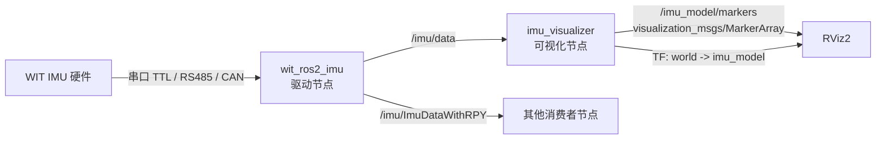

# wit_ros2_imu_ws

基于 **ROS 2 Humble** 的 WIT 系列 IMU 串口驱动工作空间，附带一个在 RViz2 中实时显示三维模型姿态的可视化节点。

支持 TTL / RS485 / CAN 三种接口、标准精度与高精度两种模式，输出标准 `sensor_msgs/Imu` 消息以及附带欧拉角的自定义消息。

---

## 功能特性

- **多种协议接入**：`TTL_STD` / `TTL_HIGH` / `RS485_STD` / `RS485_HIGH` / `CAN_STD` / `CAN_HIGH`
- **标准消息输出**：`/imu/data`（`sensor_msgs/msg/Imu`），包含加速度、角速度、四元数
- **欧拉角输出**：`/imu/ImuDataWithRPY`（`imu_msg/msg/ImuData`），额外附带 roll / pitch / yaw（单位：度）
- **三维姿态可视化**：`imu_visualizer` 节点把 IMU 姿态映射到 3D 模型上，通过 `MarkerArray` + TF 在 RViz2 中实时显示
- **一键启动**：一条 `ros2 launch` 命令拉起「驱动 + 可视化 + RViz2」

## 数据流



## 目录结构

```
wit_ros2_imu_ws/
├── src/
│   ├── imu_msg/                     # 自定义消息包 (ament_cmake)
│   │   └── msg/ImuData.msg          # Header + sensor_msgs/Imu + roll/pitch/yaw
│   └── wit_ros2_imu/                # 驱动与可视化 (ament_python)
│       ├── wit_ros2_imu/
│       │   ├── wit_ros2_imu.py      # 串口驱动节点 imuDriverNode
│       │   └── imu_visualizer.py    # 三维姿态可视化节点
│       ├── launch/
│       │   └── imu_visualize.launch.py
│       ├── rviz/
│       │   └── imu_view.rviz        # 预配置的 RViz2 布局
│       ├── script/
│       │   ├── bind_usb.sh          # 安装 udev 规则（生成 /dev/imu_usb）
│       │   └── imu_usb.rules
│       ├── package.xml
│       └── setup.py
├── build/  install/  log/           # colcon 生成目录
```

## 环境要求

| 项目 | 要求 |
|---|---|
| 操作系统 | Ubuntu 22.04 |
| ROS 2 | Humble |
| Python | 3.10+（`pyserial`、`numpy`） |
| 其他 | `rviz2`（可视化时需要，已作为 `exec_depend` 声明） |

```bash
sudo apt install ros-humble-rviz2 python3-serial python3-numpy
```

## 编译

```bash
cd ~/wit_ros2_imu_ws
source /opt/ros/humble/setup.bash

# 全量编译
colcon build

# 只编译本次改动涉及的包
colcon build --packages-select imu_msg wit_ros2_imu

source install/setup.bash
```

> 每次编译后都需要重新 `source install/setup.bash`，否则找不到新增的可执行文件（如 `imu_visualizer`）。

## 串口权限配置

Linux 下普通用户默认无法访问 `/dev/ttyUSB*`。工作空间提供了一个 udev 规则，把 CH340 串口（`1a86:7523`）映射为固定别名 `/dev/imu_usb` 并放开权限：

```bash
cd src/wit_ros2_imu/script
sudo ./bind_usb.sh
```

脚本等价于把 `imu_usb.rules` 复制到 `/etc/udev/rules.d/` 后重载规则。完成后重新插拔 USB 线，确认设备存在：

```bash
ls -l /dev/imu_usb
```

> 若使用其他 USB 转串口芯片，请修改 `imu_usb.rules` 中的 `idVendor` / `idProduct`。

---

## 运行

### 1. 启动 IMU 驱动

```bash
ros2 run wit_ros2_imu wit_ros2_imu --ros-args \
  -p port:=/dev/imu_usb \
  -p baudrate:=921600 \
  -p protocol:=TTL_STD \
  -p modbusID:=0x50
```

驱动节点会在终端以约 10 Hz 刷新打印加速度、角速度、角度、磁力计数据（打印前清屏）。

### 2. 启动三维姿态可视化

```bash
ros2 run wit_ros2_imu imu_visualizer
```

然后在另一个终端启动 RViz2，加载预置配置：

```bash
ros2 run rviz2 rviz2 -d $(ros2 pkg prefix wit_ros2_imu)/share/wit_ros2_imu/rviz/imu_view.rviz
```

### 3. 一键启动（推荐）

```bash
# 驱动 + 可视化 + RViz2
ros2 launch wit_ros2_imu imu_visualize.launch.py

# 驱动已在别处运行，只启动可视化与 RViz2
ros2 launch wit_ros2_imu imu_visualize.launch.py start_driver:=false

# 只启动节点，不启动 RViz2（例如在远程机器上）
ros2 launch wit_ros2_imu imu_visualize.launch.py use_rviz:=false

# 指定串口 / 波特率 / 话题
ros2 launch wit_ros2_imu imu_visualize.launch.py \
  port:=/dev/ttyUSB0 baudrate:=115200 imu_topic:=/imu/data
```

#### launch 参数

| 参数 | 默认值 | 说明 |
|---|---|---|
| `start_driver` | `true` | 是否启动 `wit_ros2_imu` 驱动节点 |
| `port` | `/dev/imu_usb` | 串口设备 |
| `baudrate` | `921600` | 串口波特率 |
| `imu_topic` | `/imu/data` | 可视化节点订阅的话题 |
| `use_rviz` | `true` | 是否启动 RViz2 |
| `rviz_config` | `<pkg>/rviz/imu_view.rviz` | RViz2 配置文件路径 |

---

## 话题与消息

### 发布

| 话题 | 类型 | 说明 |
|---|---|---|
| `/imu/data` | `sensor_msgs/msg/Imu` | 标准 IMU 数据，`header.frame_id = imu_link` |
| `/imu/ImuDataWithRPY` | `imu_msg/msg/ImuData` | 在上述 IMU 数据基础上附加 `roll` / `pitch` / `yaw`（**度**） |
| `/imu_model/markers` | `visualization_msgs/msg/MarkerArray` | 3D 模型与坐标轴 Marker |
| `/tf` | `tf2_msgs/msg/TFMessage` | `world` → `imu_model`，仅姿态（平移为 0） |

`imu_msg/msg/ImuData` 定义：

```
std_msgs/Header  header
sensor_msgs/Imu   imu
float64          roll
float64          pitch
float64          yaw
```

### 数据换算说明

- `linear_acceleration`：按 **±16 g** 量程线性换算（`raw * 16 / 32768`），量纲为 **g**，如需 m/s² 请自行乘 `9.80665`
- `angular_velocity`：按 **±2000 °/s** 量程换算并转成 **rad/s**
- `orientation`：由驱动内部根据欧拉角转成的四元数
- 高精度协议（`*_HIGH`）角度原始值为 `0.001°`，标准精度（`*_STD`）为 `180/32768 °`

### 查看数据

```bash
ros2 topic echo /imu/data
ros2 topic echo /imu/ImuDataWithRPY
ros2 topic hz /imu/data
```

---

## 参数说明

### 驱动节点 `wit_ros2_imu`（节点名 `imuDriverNode`）

| 参数 | 默认值 | 说明 |
|---|---|---|
| `port` | `/dev/imu_usb` | 串口设备路径 |
| `baudrate` | `921600` | 波特率 |
| `protocol` | `TTL_STD` | `TTL_STD` / `TTL_HIGH` / `CAN_STD` / `CAN_HIGH` / `RS485_STD` / `RS485_HIGH` |
| `modbusID` | `0x50` | RS485 / Modbus 从机地址 |

### 可视化节点 `imu_visualizer`（节点名 `imu_visualizer_node`）

| 参数 | 默认值 | 说明 |
|---|---|---|
| `imu_topic` | `/imu/data` | 订阅的 IMU 话题 |
| `marker_topic` | `/imu_model/markers` | Marker 输出话题 |
| `fixed_frame` | `world` | TF 父坐标系 / RViz2 Fixed Frame |
| `model_frame` | `imu_model` | TF 子坐标系（模型自身坐标系） |
| `publish_tf` | `true` | 是否广播 TF |
| `mesh_resource` | `""` | 自定义模型路径，如 `package://wit_ros2_imu/meshes/imu.dae`；为空时使用内置几何体 |
| `mesh_scale` | `1.0` | 自定义 mesh 的缩放系数 |
| `body_length` | `0.20` | 内置几何体模型长度（x） |
| `body_width` | `0.12` | 内置几何体模型宽度（y） |
| `body_height` | `0.04` | 内置几何体模型高度（z） |
| `show_axes` | `true` | 是否显示本体坐标轴箭头 |
| `axis_length` | `0.25` | 坐标轴长度 |
| `axis_shaft_diameter` | `0.012` | 箭头杆直径 |
| `axis_head_diameter` | `0.030` | 箭头头部直径 |
| `axis_head_length` | `0.05` | 箭头头部长度 |
| `smoothing` | `1.0` | 姿态 slerp 平滑系数，`1.0` 为不平滑，越小越平滑 |
| `marker_lifetime` | `0.5` | Marker 存活时间（秒），IMU 断流后模型自动消失；`0` 表示永久 |

示例：

```bash
ros2 run wit_ros2_imu imu_visualizer --ros-args \
  -p smoothing:=0.5 \
  -p mesh_resource:=package://wit_ros2_imu/meshes/imu.stl \
  -p mesh_scale:=0.8
```

---

## RViz2 三维显示

预置配置 `rviz/imu_view.rviz` 已包含：

- **Global Options → Fixed Frame**: `world`
- **Grid**：参考地面网格
- **MarkerArray**：订阅 `/imu_model/markers`
  - `id=0` 模型本体（默认 0.20 × 0.12 × 0.04 的蓝色立方体，或自定义 mesh）
  - `id=1/2/3` 本体系 X / Y / Z 轴箭头，颜色分别为红 / 绿 / 蓝
- **TF**：显示 `world` → `imu_model` 的坐标变换

> **关于位置**：IMU 只能提供姿态（orientation），无法提供位置，因此模型始终固定在世界原点，只有姿态随 IMU 变化。若要同时显示位置，需要额外融合轮式里程计 / 视觉等定位信息。

手动在 RViz2 中配置时的步骤：

1. `Fixed Frame` 设为 `world`
2. `Add` → `By topic` → `/imu_model/markers` → `MarkerArray`
3. （可选）`Add` → `rviz_default_plugins/TF`

---

## 无硬件调试

没有 IMU 硬件时，可以直接向 `/imu/data` 发布假数据验证可视化链路：

```bash
ros2 topic pub -r 10 /imu/data sensor_msgs/msg/Imu \
"{header: {frame_id: imu_link}, orientation: {x: 0.0, y: 0.0, z: 0.7071, w: 0.7071}}"
```

上例为绕 Z 轴旋转 90° 的姿态，RViz2 中模型应同步旋转。

---

## 故障排查

| 现象 | 可能原因与处理 |
|---|---|
| `could not open port /dev/imu_usb` | 未安装 udev 规则或设备名不符。执行 `script/bind_usb.sh`，检查 `ls -l /dev/imu_usb`，必要时修改 `protocol`/`port` |
| `Permission denied: '/dev/ttyUSB0'` | 当前用户不在 `dialout` 组：`sudo usermod -aG dialout $USER` 后重新登录 |
| 终端打印全为 0 / 无数据 | 波特率或协议不匹配；确认 `protocol` 与硬件型号一致，`baudrate` 与 IMU 当前配置一致 |
| 找不到 `imu_visualizer` 可执行文件 | 修改 `setup.py` 后未重新编译或未重新 `source install/setup.bash` |
| RViz2 中看不到模型 | 检查 Fixed Frame 是否为 `world`、MarkerArray 话题是否为 `/imu_model/markers`、`/imu/data` 是否有数据 |
| 日志出现 `IMU 消息中没有有效姿态` | 消息 `orientation_covariance[0] < 0`，表示该消息不含姿态解算结果，节点会忽略该帧 |
| 模型抖动明显 | 降低 `smoothing`（如 `0.3`）对姿态做低通平滑 |

---

## License

`package.xml` 中当前标记为 `TODO: License declaration`，正式发布前请补充实际许可证（如 Apache-2.0 / BSD-3-Clause）。
